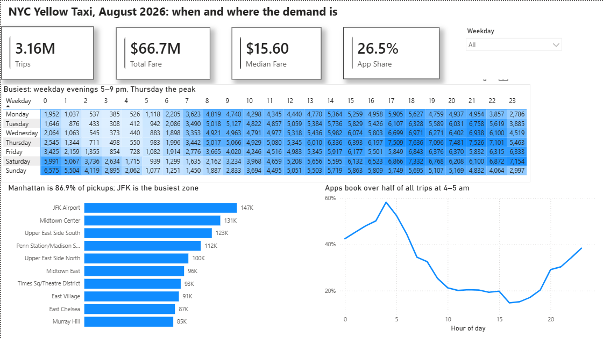
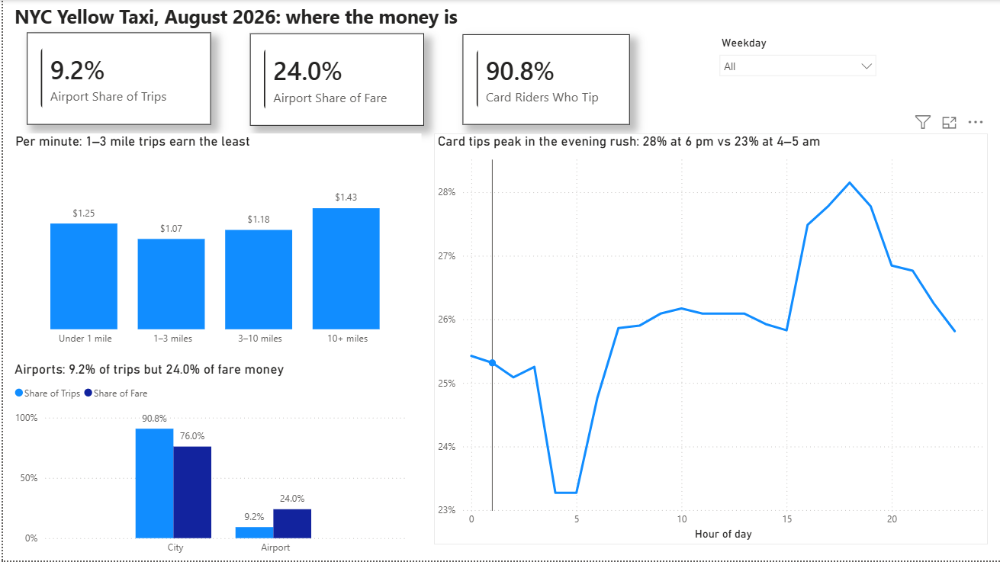

# NYC Yellow Taxi — Exploratory Data Analysis (August 2026)

An end-to-end analysis of **3.3 million New York yellow taxi trips**: checking and cleaning the raw data
in Python, answering six business questions with charts, and turning the answers into an interactive
**Power BI dashboard**.

**Tools:** Python (pandas, matplotlib, seaborn) · Jupyter Notebook · Power BI (Power Query, DAX)



---

## The business problem

The client is a **taxi company that wants to earn more and plan its drivers better**. The analysis
answers six questions:

| # | Question | Why it matters |
|---|---|---|
| Q1 | When are taxis busiest? | When to put more drivers on the road |
| Q2 | Where do most trips start? | Where drivers should wait for passengers |
| Q3 | Which trips earn the most per minute? | Which trips are worth taking |
| Q4 | How important are airport trips? | Their share of trips vs their share of money |
| Q5 | Who tips more? | Which hours and trips bring better tips |
| Q6 | How big are app bookings? | How much business comes from apps, and when |

---

## Key findings

1. **When:** demand peaks on **weekday evenings, 5–9 pm**. The busiest hour is **Thursday 6–7 pm**
   (about 7,600 trips on an average Thursday). Weekends are busy at 0–2 am and on Saturday evening;
   2–6 am is quiet.
2. **Where:** **Manhattan gives 86.9% of all pickups**. JFK Airport is the busiest single zone
   (146,596 trips, 4.6%), and just **10 zones give a third of all trips**.
3. **Earnings per minute** follow a U-shape: **10+ mile trips earn the most ($1.43/min)**, while
   **1–3 mile trips earn the least ($1.07/min)** and are also the most common trip. 5 am pays best
   ($1.39/min, empty roads); midday pays worst ($1.09/min, traffic).
4. **Airports are 9.2% of trips but 24.0% of all fare money** ($16.0M of $66.7M). An average airport
   trip earns $55.08 vs $17.65 for a city trip — about 3 city trips. Far more trips leave the
   airports than arrive (JFK: 146,596 pickups vs 28,563 drop-offs); Newark is one-way (45 pickups).
5. **Tips:** 91% of card riders tip. Tip % peaks in the **evening rush (28.2% at 6 pm)** and is
   lowest at 4–5 am (23.3%). Longer trips get bigger tips in dollars but a smaller percentage.
6. **App bookings are 26.5% of all trips**, 68.7% of them through Uber. App trips are longer
   (3.5 vs 1.7 miles median) and pay more ($22.60 vs $13.50 median fare), and apps book
   **58% of all trips at 4 am** but only about 15% at 4–5 pm.

## Recommendations

1. Put the most drivers on the road **Tuesday–Saturday, 5–10 pm**, in Midtown, Penn Station and the
   Upper East Side.
2. Keep a **steady supply of taxis at JFK and LaGuardia** — the most valuable trips in the data.
3. **Night and early-morning drivers should be on Uber**, where most of their trips come from.
4. **Encourage card payment** — only card tips can be measured, and 91% of card riders tip.

---

## Power BI dashboard

Two pages built on the cleaned data exported from the notebook. Every number was checked against
the notebook (3,161,795 trips, $66.7M total fare, 26.5% app share).

| Page | Answers | Visuals |
|---|---|---|
| **Demand** | Q1, Q2, Q6 | KPI cards, weekday × hour heatmap, top 10 pickup zones, app share by hour |
| **Money** | Q3, Q4, Q5 | KPI cards, fare per minute by trip length, airport vs city share, card tip % by hour |

- **Data model:** star schema — a `Trips` fact table with `Date`, `Zones` and `Payment` dimension tables
- **12 DAX measures**, for example `Avg Trips per Day`, `Fare per Minute`, `Card Tip %`, `Airport Share of Fare`
- A **Weekday slicer** synced across both pages



---

## The data

| | |
|---|---|
| **Source** | [NYC Taxi & Limousine Commission — Trip Record Data](https://www.nyc.gov/site/tlc/about/tlc-trip-record-data.page) |
| **File** | `yellow_tripdata_2026-08.parquet` (yellow taxi, August 2026) |
| **Size** | 3,336,716 trips × 21 columns → **3,161,795 trips after cleaning** |
| **One row** | one yellow taxi trip |
| **Units** | distance in miles, money in US dollars |
| **Lookup** | `taxi_zone_lookup.csv` — turns zone numbers into borough and zone names |
| **Column meanings** | [TLC data dictionary (PDF)](https://www.nyc.gov/assets/tlc/downloads/pdf/data_dictionary_trip_records_yellow.pdf) |

The trip data file (58 MB) is not stored in this repository — download it from the TLC page above.

---

## Data quality checks and cleaning

**What the checks found**

- **27.6% of trips have the same 5 columns empty** (passenger count, rate code, store-and-forward flag,
  congestion surcharge, airport fee). Every one is `payment_type 0` — a **Flex Fare trip booked in an
  app** — where the meter leaves those columns blank. These are real trips, so they were **kept**.
- **7 exact duplicate rows**, all 0-second, 0-mile broken records in an unknown zone.
- **Impossible values:** pickups dated 2009, a 223,198-mile trip, negative fares and tips.

**Cleaning rules**

| Rule | Trips | Decision |
|---|---|---|
| Pickup not in August 2026 | 15 | delete |
| Duration ≤ 0 minutes | 43,185 | delete |
| Duration over 3 hours (mostly meters left running: median 21 hours for 3 miles) | 873 | delete |
| Distance = 0 | 119,059 | delete |
| Distance over 100 miles | 135 | delete |
| Fare ≤ $0 (refunds and corrections) | 17,249 | delete |
| Fare over $100 for under 1 mile (impossible combination) | 531 | delete |
| 0 passengers (the trip itself is fine) | 7,478 | keep |

One trip can break several rules, so the total removed is **174,921 trips (5.24%)**.
The rule behind every decision: *drop a row only when it is wrong, not when it is different.*

---

## Interesting discoveries

- **"Missing" values that were not errors:** 27.6% of trips looked incomplete, but they were app bookings.
- **The $0 tip trap:** tips looked unrelated to fares (Spearman r = 0.07) because cash tips are never
  recorded. For card trips only, the link is clear (r = 0.59), so all tip analysis uses card trips.
- **The 5-vs-4 weekday trap:** August 2026 has five Saturdays, Sundays and Mondays but only four of every
  other day, so busy-ness is measured as **average trips per day**, not raw counts.
- **Errors that only show in two columns together:** an $800 fare and a 0.01-mile trip each look possible
  alone; together they are impossible.

---

## Repository structure

```
├── README.md
├── EDA_Project_Final.ipynb          # full analysis: checks, cleaning, Q1–Q6, summary
├── NYC_Taxi_Dashboard.pbix          # Power BI dashboard (2 pages)
├── NYC_Taxi_EDA_Presentation.pdf    # presentation slides
├── taxi_zone_lookup.csv             # zone lookup table (TLC)
├── requirements.txt
├── .gitignore
└── images/
    ├── page1_demand.png
    └── page2_money.png
```

## How to run

1. Clone this repository.
2. Download `yellow_tripdata_2026-08.parquet` from the
   [TLC trip record page](https://www.nyc.gov/site/tlc/about/tlc-trip-record-data.page) into the same folder.
3. Install the libraries: `pip install -r requirements.txt`
4. Open `EDA_Project_Final.ipynb` and run **Kernel → Restart & Run All**.
   The last code cell exports `taxi_clean_powerbi.parquet` for Power BI.
5. To refresh the dashboard, open `NYC_Taxi_Dashboard.pbix`, go to **Transform data → Trips →
   Advanced Editor**, and change the file path to where your `taxi_clean_powerbi.parquet` is.

---

## Limits

- One month of data only; other months may look different.
- The data does not show the time drivers spend empty between trips.
- Tips are recorded only for card payments.
- The meaning of the app codes A, CC and EH is not given in the data dictionary.

---

**Author:** Vishal Surwase
